 

### 🎨 A full photo studio that lives inside your browser tab.
**Edit · Convert · Compress · Remove Backgrounds · Resize** — with on-device AI. 
No uploads. No servers. No paywalls.

 

 

[**✨ Features**](#-five-tools-zero-uploads) &nbsp;•&nbsp;
[**🧠 On-device AI**](#-on-device-ai) &nbsp;•&nbsp;
[**🔒 Privacy**](#-privacy-by-design) &nbsp;•&nbsp;
[**🖥️ Desktop**](#️-apic-for-pc) &nbsp;•&nbsp;
[**❓ FAQ**](#-faq) &nbsp;•&nbsp;
[**📄 License**](#-license)

 

---

## 👋 What is APIC?

**APIC** (*Advanced Image Processing Center*) is a free online photo editor that runs **entirely in your browser**. Open the page, drop in a picture, and get to work. Your image is processed on **your own device**, so nothing is sent to a server, there's no queue, and there's no watermark.

> 💡 **The idea:** most online image tools quietly upload your photos to someone else's computer. APIC flips that. The tools come to you, and your photos stay with you.

 

## ⚡ Five Tools. Zero Uploads.

<table>
  <tr>
    <td align="center" width="20%">
      <h3>🖌️ Edit</h3>
      Filters, brightness, contrast, saturation, blur, rotate and flip, <b>live on canvas</b>.
    </td>
    <td align="center" width="20%">
      <h3>🔁 Convert</h3>
      PNG, JPEG, WebP, BMP, ICO or PDF. <b>Six formats</b>, no round trips to a server.
    </td>
    <td align="center" width="20%">
      <h3>📦 Compress</h3>
      Smart <b>target-size search</b> finds the best quality that fits your file size limit.
    </td>
    <td align="center" width="20%">
      <h3>✂️ Remove BG</h3>
      <b>On-device AI</b> cuts your subject out cleanly. No upload, no waiting in line.
    </td>
    <td align="center" width="20%">
      <h3>📐 Resize</h3>
      Exact <b>pixel or percent</b> dimensions with step-down resampling for crisp results.
    </td>
  </tr>
</table>

 

## 🎛️ Pro Colour Tools

Not just sliders. APIC ships with the kind of colour tools you'd expect from desktop editors:

| Tool | What it does |
|:--|:--|
| 📊 **Live Histogram** | See your tonal range update in real time as you edit |
| 📈 **RGB Curves** | Shape shadows, mids and highlights per channel |
| 🌈 **HSL Colour Mixer** | Fine-tune the hue, saturation and luminance of individual colours |
| 🎬 **3-Way Colour Grading** | Grade shadows, midtones and highlights separately |
| 🔍 **Clarity** | Add punch and local contrast |
| 🎞️ **Grain** | Add film-style texture |
| 🧊 **3D LUT Export** | Export your look as a `.cube` file for use in other tools |

 

## 🧠 On-Device AI

APIC runs real AI models **inside your browser** using **ONNX Runtime + WebAssembly**. The first time you use an AI tool, the model downloads once and is **cached on your device**. After that it starts fast and works without sending anything anywhere.

### ✂️ Background Remover

| Mode | Model size (first download) | Best for |
|:--|:--:|:--|
| 🟢 **Lite** | ~5 MB | Quick cutouts, slow connections, phones |
| 🔵 **Fast** | ~44 MB | Everyday photos with a good balance of speed and quality |
| 🟣 **Maximum** | ~176 MB | Hair, fine edges and tricky subjects (multi-pass, slower) |

### 🪄 Object Remover

Paint over something you want gone, such as a person, a sign or a blemish, and AI inpainting fills the area to match its surroundings.

| Engine | Model | Notes |
|:--|:--|:--|
| ⚡ **Fast** | MI-GAN (~44 MB) | Great for small objects and quick fixes |
| 💎 **Ultra** | LaMa (~208 MB) | Highest accuracy, offered on desktop-class devices |

> 🛟 If a model download stalls, APIC retries automatically and shows a **Retry** button if it still can't connect.

 

## 🔒 Privacy by Design

- 🛡️ **Your images never leave your device.** Every tool runs locally.
- 🙅 **No account needed to edit.** Use every tool freely.
- 🔑 **Sign in only to export**, with one tap using Google. This only uses your name, email and photo for your account.
- 🌗 **Light, dark or system theme**, remembered for next time.

 

## 🖥️ APIC for PC

Prefer it on your desk? **APIC for PC** is a Windows app that runs **fully offline** with the same edit, convert and compress tools. No account needed.

 

## 🧰 Built With

A single-page, client-side app: canvas-based image pipeline, ONNX models running on WebAssembly, Firebase for Google sign-in, and GitHub Pages for hosting.

 

## ❓ FAQ

<b>Is APIC really free?</b>

 
Yes. There are no paid tiers. You can use every tool without an account and sign in with Google only when you export your work.

<b>Are my photos uploaded to a server?</b>

 
No. Editing, converting, compressing, resizing, background removal and object removal all run on your own device.

<b>Which formats can I convert between?</b>

 
PNG, JPEG, WebP, BMP, ICO and PDF. Use <b>PNG or WebP</b> if you want to keep a transparent background after removing it.

<b>Can I compress an image to an exact file size?</b>

 
Yes. The Compress tool searches for the best quality that fits your target size, so you can meet an upload limit without guessing.

<b>Why is the first AI run slower?</b>

 
AI tools download their model once. After that it's cached in your browser, so later runs start much faster, even with a weak connection.

<b>Is there an offline version?</b>

 
Yes, <b>APIC for PC</b> is a Windows app that works fully offline. See the <a href="#️-apic-for-pc">desktop section</a> above.

 

## 🐛 Found a Bug or Have an Idea?

Open an issue on the [APIC issue tracker](https://github.com/Akhouri-Anmol-Kumar/APIC/issues). Feedback is always welcome.

 

## 📄 License

**Copyright © 2026 Akhouri Anmol Kumar. All Rights Reserved.**

This project is proprietary. You're welcome to use the live website and read the source for personal learning, but copying, re-hosting or building derivative products is **not permitted** without written permission. See [`LICENSE`](LICENSE) for the full terms.

 

### 💚 Made with care by [Akhouri Anmol Kumar](https://github.com/Akhouri-Anmol-Kumar)
**An Akhouri Systems product**

 

⭐ If APIC helped you, a star on this repo means a lot!

